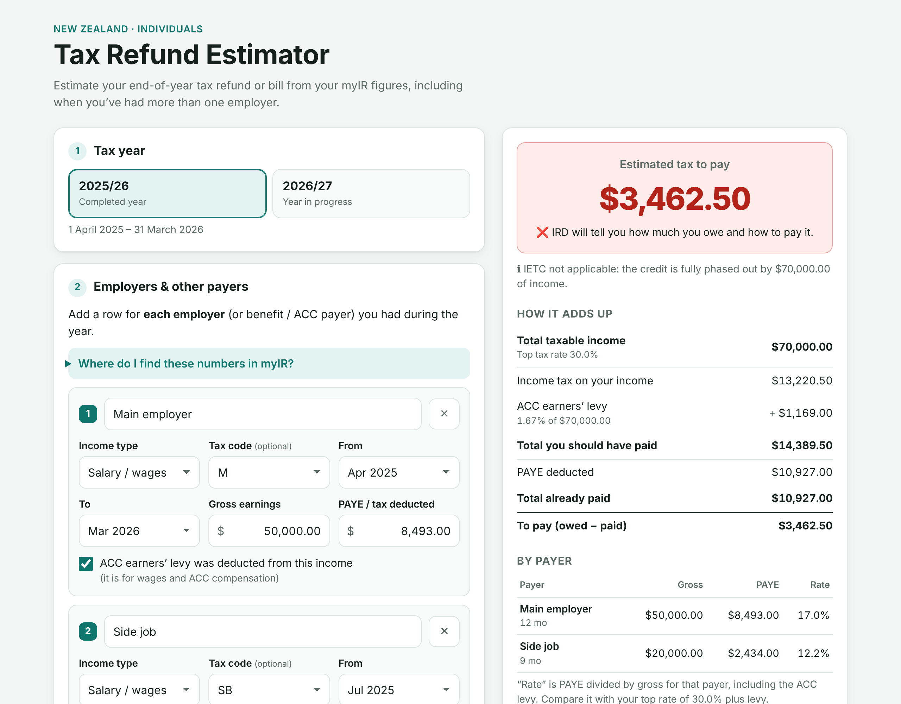

# NZ Tax Refund Estimator

A single-page app that estimates your New Zealand end-of-year income tax **refund or bill**, using the figures in your myIR **Income summary**. It is built from the "Tax Refund Calculator" tab of the NZ Finance Bundle spreadsheet.

**Live:** https://rlaput.github.io/nz-tax-refund-estimator/



## How to use

1. **Pick the tax year.** 2025/26 is the latest completed year; 2026/27 is in progress.
2. **Add each employer or payer.** In [myIR](https://myir.ird.govt.nz), go to **My income → Income summary** and copy each payer's *gross earnings* and *PAYE* into its own row. Pasting values like `$12,345.67` works. Set the months you were paid, and the tax code if you know it.
3. **Optionally add interest and dividends** from the same myIR screen: gross amount, RWT and imputation credits.
4. **Answer the IETC questions**, saying whether you had a main benefit, Working for Families, NZ Super or non-residence, and for how many months.
5. **Read the result.** The panel shows the refund or amount to pay, how it adds up, a table for each payer, and notes on what's driving the result.

## What it does

- **Multiple employers and payers.** Add one row per employer, ACC weekly compensation, benefit or NZ Super payer. Each row has gross earnings, PAYE, tax code and the months worked. Income is combined and taxed through the progressive bands, which is where over- or under-deductions from secondary tax codes (SB/S/SH/ST/SA) show up.
- **ACC earners' levy.** PAYE figures from myIR and payslips include the levy, so the app counts it as part of what you owe. Leaving it out, as the original spreadsheet did, overstates refunds by about 1.67% of income. If several employers together deducted levy above the yearly maximum, that excess is refunded too.
- **IETC.** Up to $520, reduced 13c per dollar from $66k to $70k. It drops by 1/12 for each month you received a main benefit, NZ Super or Working for Families, or weren't NZ resident. ME tax code users are handled automatically, because their lower PAYE already reflects the credit.
- **Interest and dividends (optional).** These count toward taxable income, with credit for RWT and imputation. Imputation credits are capped so they can't create a refund on their own.
- **Explains the result.** Shows a breakdown, the PAYE rate for each payer, and notes on what is driving the result (secondary-code shortfalls, part-year earners, levy over the cap, and so on).
- Entries autosave in your browser (localStorage only; nothing is sent anywhere). Works on phones, supports dark mode, and has a print/PDF layout.

## Tax years and rates

| Year | Income tax bands | ACC earners' levy | IETC |
|---|---|---|---|
| 2025/26 | 10.5% to $15,600 · 17.5% to $53,500 · 30% to $78,100 · 33% to $180,000 · 39% above | 1.67% up to $152,790 | $520, $24k–$70k |
| 2026/27 | unchanged | 1.75% up to $156,641 | unchanged |

The spreadsheet's bands were already correct for 2025/26. They were last changed on 31 July 2024 (Budget 2024), and Budget 2026 left them as they were. All rates live in [`src/tax/years.ts`](src/tax/years.ts). To add a new tax year, add one entry there.

Sources: [IRD tax rates for individuals](https://www.ird.govt.nz/income-tax/income-tax-for-individuals/tax-codes-and-tax-rates-for-individuals/tax-rates-for-individuals), [IRD IETC](https://www.ird.govt.nz/ietc), and the IRD Payroll Calculations & Business Rules Specification 2026 (ACC levy).

Not covered: student loan, Working for Families entitlement, self-employment, rental or overseas income, and donation tax credits.

## Differences from the spreadsheet

| | Spreadsheet | This app |
|---|---|---|
| Income sources | One total | One row per employer or payer, plus interest and dividends |
| ACC earners' levy | Ignored, so refunds are overstated by about 1.67% of income | Included, with excess levy above the cap refunded |
| IETC pro-rating | By months *worked* | By months *eligible* (IRD's rule): months on a benefit, NZ Super or WFF, or non-resident, reduce it |
| Tax years | 2025/26 | 2025/26 and 2026/27, set in one config file |
| Explanation | A single result line | Breakdown, a table per payer, and notes such as secondary-code shortfalls and part-year earnings |

## Project structure

```
src/
  tax/
    years.ts         # tax bands, IETC and ACC parameters for each tax year
    engine.ts        # pure calculation engine (no DOM)
    engine.test.ts   # Vitest unit tests, including a check against the spreadsheet formula
  ui/
    form.ts          # input form markup
    results.ts       # results panel
    info.ts          # tax bands, explainers, disclaimer
    state.ts         # state, localStorage autosave, money parsing
  main.ts            # wiring and event handling
  styles.css
index.html
.github/workflows/deploy.yml   # test, build and deploy to GitHub Pages
```

## Development

```bash
npm install
npm run dev      # local dev server
npm test         # unit tests for the tax engine (Vitest)
npm run build    # type-check + production build into dist/
```

The project uses Vite and vanilla TypeScript with no runtime dependencies. The calculation logic is in [`src/tax/engine.ts`](src/tax/engine.ts) and has no DOM code. The UI is in `src/ui/`.

## Deploying to GitHub Pages

[`.github/workflows/deploy.yml`](.github/workflows/deploy.yml) tests, builds and deploys on every push to `main`. One-time setup: in the repo go to **Settings → Pages → Build and deployment → Source: GitHub Actions**.

The site is served from `/nz-tax-refund-estimator/`, which is set as `base` in `vite.config.ts`. If you rename the repo, update `base` to match.

## Disclaimer

This gives an estimate only and is not tax advice. IRD confirms the final amount in your income tax assessment.
